# Controlador de iluminación con consola serial (STM32 NUCLEO-F446RE)

Primer Parcial 1L C3-2026 · Code Challenge · Aplicación bare-metal en C, sin RTOS.

- Estudiante: Josué Hiraldo
- Matrícula: 20240705
- Placa: STM32 NUCLEO-F446RE (MCU STM32F446RETx, Cortex-M4)

> **Adaptación de placa.** El enunciado está planteado para la FRDM-MCXA156.
> Con autorización del docente, el trabajo se implementa en la NUCLEO-F446RE,
> usando los periféricos equivalentes que se listan abajo.

## Video de demostración

**Video (3–5 min, Google Drive): [Video en Google Drive](https://drive.google.com/drive/folders/1ppLJ-GPRubpzerDcrkRa_R3TKzFTk_N-?usp=sharing)**

Muestra el arranque, los LED en cada estado (fijo en MANUAL, 500 ms en AUTO, 125 ms en PAUSA), la rampa del LED externo,
las órdenes y los errores de la consola, el botón B1 (corta y larga) y los resultados de las pruebas.

## Versiones de herramientas

| Herramienta | Versión |
|---|---|
| STM32CubeIDE | 2.2.0 |
| STM32CubeMX | 6.18.1 |
| Paquete de firmware | STM32Cube FW_F4 V1.28.3 |
| Terminal serie | Tera Term |

## Equivalencias con el enunciado

| Enunciado (FRDM-MCXA156) | Esta implementación (NUCLEO-F446RE) |
|---|---|
| PWM por CTIMER, pin P3_12 | TIM3, canal 1, pin PA6 |
| Tick de 1 ms con CTIMER | TIM6, interrupción de actualización |
| LPUART por MCU-Link | USART2 (PA2/PA3) por el ST-LINK |
| Pulsador con interrupción GPIO | B1 (PC13) con EXTI13, ambos flancos |
| LED de estado de la placa | LD2 (PA5) |
| Osciloscopio o analizador lógico para verificar el PWM | Medición interna: TIM2 en modo «entrada PWM» sobre PA0, con un puente desde PA6 (método aceptado por el docente) |

## Tabla de recursos

| Función | Pin | Conector | Polaridad | Periférico / canal | Reloj | IRQ |
|---|---|---|---|---|---|---|
| LED de estado | PA5 | LD2 de la placa | Activo en alto | GPIO de salida | — | — |
| Pulsador de usuario | PC13 | B1 de la placa | Activo en bajo | EXTI13, ambos flancos, pull-up | — | EXTI15_10_IRQn |
| PWM al LED externo | PA6 | CN5, pin 5 (D12) | Activo en alto | TIM3_CH1, PWM mode 1 | 84 MHz | Ninguna |
| Medidor interno del PWM | PA0 | CN8, pin 1 (A0), con puente a PA6 | Entrada con pull-down | TIM2_CH1, modo entrada PWM (CH1 y CH2) | 84 MHz | Ninguna (sondeo) |
| Tick de 1 ms | — | — | — | TIM6 | 84 MHz | TIM6_DAC_IRQn |
| Consola serie | PA2 (TX), PA3 (RX) | Puerto serie virtual del ST-LINK | — | USART2, 115200 8N1 | 42 MHz (PCLK1) | USART2_IRQn |

Sin conflictos de pin mux entre estas funciones.

Polaridades medidas en la placa durante el Hito 1: LD2 es activo en alto (PA5 en alto = encendido)
y B1 es activo en bajo (reposo = 1, pulsado = 0). Detalle en `pruebas/hito1_resultados.md`.

## Reloj efectivo y cálculos

Configuración de reloj (captura en `evidencias/`): HSI 16 MHz → PLL → SYSCLK = HCLK = 84 MHz.
APB1 = 42 MHz (prescaler /2) y relojes de timer de APB1 = 84 MHz. TIM3 y TIM6 cuelgan de APB1.

| Timer | Prescaler | Período (ARR) | Resultado |
|---|---|---|---|
| TIM6 | 83 | 999 | 84 MHz / 84 = 1 MHz; / 1000 = 1 kHz (tick de 1 ms) |
| TIM3 a 500 Hz | 83 | 1999 | 1 MHz / 2000 = 500 Hz |
| TIM3 a 1000 Hz | 83 | 999 | 1 MHz / 1000 = 1000 Hz |
| TIM3 a 2000 Hz | 83 | 499 | 1 MHz / 500 = 2000 Hz |
| TIM2 (medidor) | 0 | 4294967295 | 84 MHz; una cuenta = 11,9 ns |

El valor de comparación es CCR = duty × (ARR + 1) / 100. Para 0 % se usa CCR = 0 y para 100 % se usa CCR = ARR + 1.
El firmware calcula ARR y CCR con el reloj real del temporizador (leído de RCC) y el PSC del registro, no con una frecuencia supuesta.
La base de tiempo de 1 ms (TIM6) no cambia al modificar la frecuencia del PWM (TIM3).

## Esquema de conexiones

- PA6 (CN5, pin 5, D12) → resistencia de 1 kΩ → ánodo del LED externo → cátodo a GND (CN5, pin 7).
- Puente (cable Dupont) de PA6 (CN5, pin 5, D12) a PA0 (CN8, pin 1, A0): la entrada de captura de TIM2 mide el PWM de PA6 (foto en `evidencias/hito3/03_conexion_pa6_pa0.jpg`).
- USB del ST-LINK a la PC: alimentación, programación y puerto serie virtual.

## Diagrama de estados

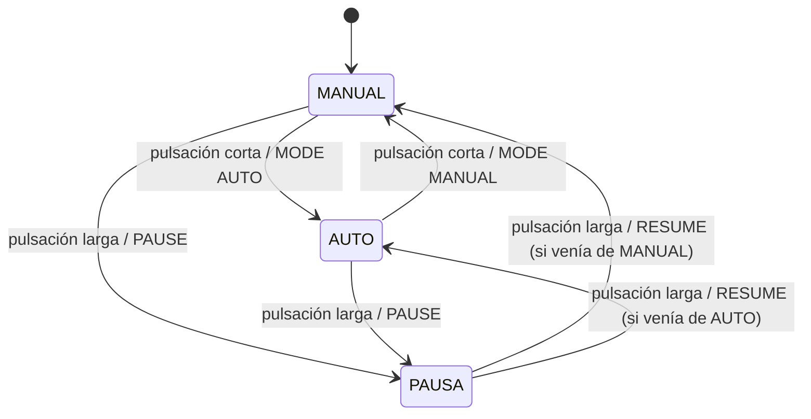

## Compilación y ejecución

1. Abrir STM32CubeIDE 2.2.0 e importar `Parcial_20240705` con
   *Import STM32 Project → STM32CubeMX/STM32CubeIDE Project*.
2. Compilar con *Build Project*.
3. Cargar con *Run* o *Debug* usando el ST-LINK de la placa.
4. Abrir el puerto serie virtual del ST-LINK a 115200 baudios, 8 bits, sin paridad,
   1 bit de parada y sin control de flujo.

## Estructura del repositorio

| Carpeta | Contenido |
|---|---|
| `Parcial_20240705/` | Proyecto de STM32CubeIDE (`Src/`, `Inc/`, `Drivers/`, `.ioc`) |
| `analisis/` | Documentos de diseño (`uart_buffers.md`: buffers UART; `tick_y_antirrebote.md`: tick, EXTI y antirrebote; `pwm_y_medicion.md`: PWM, medición interna y limitaciones; `estados_y_comandos.md`: máquina de estados, intérprete de órdenes y telemetría) |
| `pruebas/` | Resultados de pruebas (`hito1_resultados.md` ... `hito5_resultados.md`), pruebas de lógica en PC (`host/`) y herramientas de las pruebas de aceptación (`herramientas/`: macros de Tera Term, `analizar_logs.py` y `LEEME.md`) |
| `evidencias/` | Capturas, fotos, mediciones y registros (`hito1/`, `hito2/`, `hito3/`, `hito4/`; `hito5/`: registros `.log` de las pruebas de aceptación y `analisis_logs.txt`). El enlace al video está al inicio de este README |

## Código del SDK y aporte propio

- Generado por CubeMX y HAL: `Drivers/`, inicialización de periféricos (`gpio.c`, `tim.c`,
  `usart.c`), `main.c` base y manejadores de interrupción generados.
- Código de la aplicación (no generado por CubeMX ni incluido en el HAL), en `Inc/` y `Src/`:
  - `ringbuf.c/.h`: buffer circular con un productor y un consumidor.
  - `console.c/.h`: consola UART no bloqueante (RX por interrupción, cola TX, contadores de errores).
  - `tick.c/.h`: base de tiempo de 1 ms con la interrupción de TIM6 (SysTick queda solo para el HAL).
  - `button.c/.h`: pulsador B1 con EXTI en ambos flancos, antirrebote de 30 ms y pulsación corta/larga.
  - `pwm.c/.h`: PWM de hardware con TIM3 (frecuencia, duty, 0 % y 100 % exactos, escritura segura de ARR y CCR).
  - `pwm_meter.c/.h`: medidor interno con TIM2 en modo entrada PWM (periodo y tiempo en alto por hardware).
  - `pwm_check.c/.h`: verificación del PWM sin esperas (medida única y autoprueba de 15 combinaciones).
  - `ctrl.c/.h`: máquina de estados MANUAL / AUTO / PAUSA, rampa de AUTO y patrones del LED.
  - `line.c/.h`: armado de líneas de orden (CR, LF y CRLF, 63 caracteres, descarte hasta el terminador).
  - `cmd.c/.h`: análisis de órdenes y validación numérica estricta.
  - `shell.c/.h`: ejecución de órdenes, respuestas, telemetría `TEL`, eventos `EVT` y órdenes de diagnóstico `DIAG`.
  - `app_config.h`: pines, polaridades, tiempos, PWM, rampa, telemetría y tamaños de buffer.
  - `app.c/.h`: arranque y ciclo principal que conecta los módulos (no hay lógica de control en `main.c`).
- TIM2 se añadió en CubeMX (`.ioc`, `tim.c`, `tim.h`, `main.c`) para documentar el pin PA0 y el temporizador; el medidor reescribe sus registros de forma explícita.
- Cambios propios en archivos generados: solo tres líneas en los bloques `USER CODE` de `main.c`
  (`#include "app.h"`, `App_Init();` y `App_Loop();`).
- `pruebas/host/`: pruebas de lógica que se compilan en un PC con funciones simuladas del HAL.

## Pruebas de aceptación

Las 13 pruebas del enunciado se ejecutaron en la placa con el firmware del Hito 4, sin cambios. Los registros completos están en
`evidencias/hito5/` y el análisis de cada uno en `evidencias/hito5/analisis_logs.txt` (**124 de 124 comprobaciones correctas**).
Detalle, observaciones y limitaciones en `pruebas/hito5_resultados.md`.

| # | Prueba | Resultado esperado | Resultado en la placa | Estado | Registro (`evidencias/hito5/`) |
|---|---|---|---|---|---|
| 1 | Encendido | MANUAL, 1000 Hz, 25 %, STREAM OFF | `STATUS` tras RESET: `mode=MANUAL freq=1000 duty=25 stream=OFF` | Hecho | `prueba_00_humo.log` |
| 2 | `DUTY 0 / 50 / 100` | Nivel bajo / 50 % / nivel alto | 0 %: sin flancos, nivel bajo; 50 %: 50,00 % (+0,00 pp); 100 %: sin flancos, nivel alto | Hecho | `prueba_01_duty_freq.log` |
| 3 | `FREQ 500 / 1000 / 2000` | Error ≤ 2 %; el tick sigue en 1 ms | +0,00 % en las tres; `TEL` separadas exactamente 1000 ms durante los cambios | Hecho | `prueba_01_duty_freq.log` |
| 4 | AUTO durante 3,2 s | Regresa a 10 % tras subir a 90 % y bajar | `TEL` coincide con el triángulo 10-90-10 de ciclo 3,2 s (diferencia máxima 1 punto) | Hecho | `prueba_02_auto_pausa.log` |
| 5 | 20 pulsaciones cortas | 20 eventos, sin duplicados | 20 `EVT B1 short ok`, `n_short` de 1 a 20, `short=20` | Hecho | `prueba_08_boton.log` |
| 6 | Mantener el botón 3 s | Una larga; al soltar no genera corta | Una `EVT B1 long ok`, sin corta al soltar: `short=20 long=1` | Hecho | `prueba_08_boton.log` |
| 7 | PAUSA desde AUTO y RESUME | Duty 0 en pausa; continúa desde el valor y la dirección guardados | `duty=0` en PAUSA; `ramp=16 dir=down` sin cambios en 2,5 s; `RESUME` continúa con el mismo ritmo | Hecho | `prueba_02_auto_pausa.log` |
| 8 | `DUTY 20abc` / `-1` / `101` | ERR, sin modificar el duty | `ERR ARG`, `ERR RANGE`, `ERR RANGE`; con 19 órdenes inválidas el duty siguió en 40 | Hecho | `prueba_03_errores_y_lineas.log` |
| 9 | Línea de 100 caracteres y luego `STATUS` | `ERR OVERFLOW`; `STATUS` posterior funciona | `ERR OVERFLOW` y `STATUS` normal; límite exacto: 63 caracteres OK, 64 `ERR OVERFLOW` | Hecho | `prueba_03_errores_y_lineas.log` |
| 10 | CR, LF y CRLF | Una ejecución por orden | 20 respuestas para 20 órdenes, en orden; `cmd_ok` +18 exacto | Hecho | `prueba_04_terminadores.log` |
| 11 | `STREAM ON` y 10 órdenes/s por 30 s | Sin reinicios ni pérdidas; rampa y botón operativos | 300 órdenes sin errores ni pérdidas (`cmd_ok=305`, `err_*=0`, `rx_lost=0`, `tx_drop=0`), rampa y 6 pulsaciones de B1 atendidas; ritmo logrado 8,1 órdenes/s | Hecho (ritmo 8,1/s) | `prueba_05_carga_10_por_segundo.log` |
| 12 | Desbordamiento de RX provocado | Error contabilizado y recuperación en la siguiente línea | `ERR OVERFLOW`, `err_ovf=1 rx_lost=233`; `DUTY 44` siguiente se ejecutó y no se ejecutó ningún fragmento | Hecho | `prueba_06_overflow_rx.log` |
| 13 | Tiempo cerca de UINT32_MAX | La temporización continúa al desbordar | `up=4294967248` → `up=952`, `TEL` siempre a 1000 ms y rampa a 20 ms por punto tras la vuelta | Hecho | `prueba_07_desbordamiento_uint32.log` |

Duty de 25, 50 y 75 % (tolerancia ±2 puntos): autoprueba del Hito 3, 15/15 combinaciones, error de duty máximo −0,01 puntos
(`evidencias/hito3/06_autoprueba_15_de_15.png`); 50 % repetido por orden de consola en las tres frecuencias en las pruebas 2 y 3 del Hito 5.

Tiempos de respuesta (órdenes ≤ 100 ms, botón ≤ 50 ms): garantizados por diseño (`main` nunca espera, cola TX, antirrebote de 30 ms) y
comprobados en el simulador de PC; no se midieron en la placa con un reloj externo (ver `pruebas/hito5_resultados.md`).

Resultados anteriores: GPIO y consola (Hito 1) en `pruebas/hito1_resultados.md`; tick, interrupción del botón y antirrebote (Hito 2)
en `pruebas/hito2_resultados.md`; PWM y su medición (Hito 3) en `pruebas/hito3_resultados.md`; aplicación integrada, consola y botón
(Hito 4) en `pruebas/hito4_resultados.md`.

### Cómo repetir las pruebas de aceptación

1. Pulsar RESET y abrir Tera Term en el puerto del ST-LINK (115200 8N1, sin control de flujo, Local echo apagado, Enter = CR).
2. Control → Macro… y elegir una de `pruebas/herramientas/prueba_0N_*.ttl` (si el repositorio está en otra ruta, cambiar la línea
   `logfile = '...'` de la macro). Cada macro deja su registro en `evidencias/hito5/`.
3. La prueba del botón (20 cortas y una larga) se hace a mano con `STREAM ON`; el procedimiento está en `pruebas/herramientas/LEEME.md`.
4. `python pruebas/herramientas/analizar_logs.py` (Python 3, sin dependencias) revisa los registros y muestra OK o FALLA por comprobación.
5. Pruebas de lógica en PC: `sh pruebas/host/run_tests.sh` (requiere `gcc`).

Extracto del registro de la prueba del botón (`prueba_08_boton.log`):

```
EVT B1 short ok mode=AUTO duty=10 n_short=1 n_long=0
EVT B1 short ok mode=MANUAL duty=25 n_short=2 n_long=0
...
EVT B1 short ok mode=MANUAL duty=25 n_short=20 n_long=0
EVT B1 long ok mode=PAUSA duty=0 n_short=20 n_long=1
OK mode=PAUSA freq=1000 duty=0 manual=25 ramp=77 dir=up resume=MANUAL ... short=20 long=1 short_ign=0 ... err_cmd=0 ... rx_lost=0 uart_err=0 tx_drop=0
```

### Verificación de frecuencia y duty del PWM

No se dispone de osciloscopio ni de analizador lógico. El docente indicó que esa medición puede omitirse cuando no se dispone del instrumento, y aceptó por escrito que, aun así, se verifique con una medición interna (`evidencias/hito3/08_mensaje_al_profe_y_respuesta`):

- Método: puente de PA6 a PA0; TIM2 en modo «entrada PWM» captura el periodo (flanco de subida) y el tiempo en alto (flanco de bajada) con una resolución de 11,9 ns. Se promedian los periodos de una ventana de 200 ms.
- Resultado con el puente (autoprueba de 15 combinaciones: 500, 1000 y 2000 Hz con 0, 25, 50, 75 y 100 %): **15/15 correctas**. Error de frecuencia +0,00 % en todos los casos con flancos y error de duty máximo de -0,01 puntos (tolerancia pedida: ±2 puntos). Con 0 % y 100 % la salida es un nivel constante sin ningún flanco en 200 ms.
- Prueba de control sin el puente: 3/15 (solo pasan las de 0 %), lo que demuestra que el medidor detecta una señal ausente.
- **Limitación:** TIM2 y TIM3 comparten el reloj, así que la medición no es un instrumento independiente: valida los registros, los cálculos y los niveles, no la exactitud absoluta del oscilador (HSI: ±1 % a 25 °C según el datasheet). Detalle en `analisis/pwm_y_medicion.md`.

## Hitos y commits

| Hito | Estado | Commits y evidencia |
|---|---|---|
| 1. GPIO y consola | Hecho (2026-10-09) | `Agrego buffer circular y consola UART2 no bloqueante`; `Hito 1: pruebo LD2, lectura de B1 y consola por USART2`; `Hito 1: agrego evidencias, analisis de buffers y resultados`. Evidencias en `evidencias/hito1/` |
| 2. Interrupciones y antirrebote | Hecho (2026-10-10) | `Agrego tick de 1 ms con interrupcion de TIM6`; `Agrego boton B1 con EXTI en ambos flancos y antirrebote de 30 ms`; `Hito 2: integro tick y boton en la app, con pruebas en PC y analisis`; commit de evidencias del Hito 2. Evidencias en `evidencias/hito2/` |
| 3. TIMER y PWM | Hecho (2026-10-10) | `Configuro TIM2 en CubeMX para medir el PWM`; `Agrego modulo PWM con TIM3: frecuencia, duty y niveles 0 y 100 %`; `Agrego medidor interno del PWM con TIM2 en modo captura`; `Hito 3: autoprueba del PWM y teclas de control`; `Hito 3: agrego evidencias, resultados y actualizo el README`. Evidencias en `evidencias/hito3/` |
| 4. Integración y comandos | Hecho (2026-10-10) | `Hito 4: lectura de linea y analisis de ordenes (line, cmd) con pruebas`; `Hito 4: maquina de estados MANUAL/AUTO/PAUSA y rampa (ctrl)`; `Hito 4: interprete de ordenes, telemetria e integracion (shell, app, consola)`; `Hito 4: evidencias, resultados y README`. Evidencias en `evidencias/hito4/` |
| 5. Pruebas y correcciones | Hecho (2026-10-11) | `Hito 5: macros de Tera Term y analizador de registros`; `Hito 5: registros de las pruebas de aceptacion`; `Hito 5: resultados, README y enlace al video`. Evidencias en `evidencias/hito5/` |

### Hito 1: GPIO y consola

- Compilación: 0 errores y 0 advertencias (text 21 232 B, data 92 B, bss 3 980 B).
- Consola por USART2 a 115200 8N1: banner, teclas de prueba y contadores de errores sin fallos.
- LD2: se enciende con la tecla `1` y se apaga con `0`; activo en alto.
- B1: nivel 1 en reposo y 0 al pulsar; activo en bajo. En este hito se lee por sondeo solo para medir la polaridad.
- Una ráfaga de más de 128 caracteres pasó sin pérdidas: `overflow_buffer=0`, `mensajes_descartados=0`, `ORE/FE/NE/PE=0`.

| LD2 encendido (tecla `1`) | LD2 apagado (tecla `0`) |
|---|---|
| 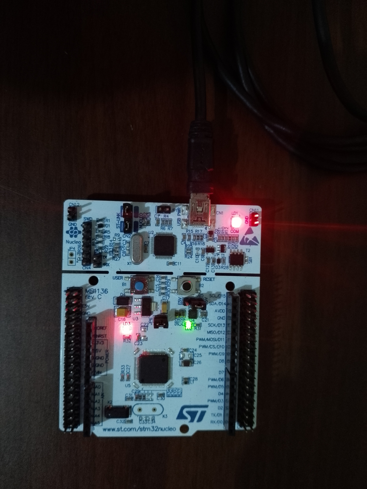 | 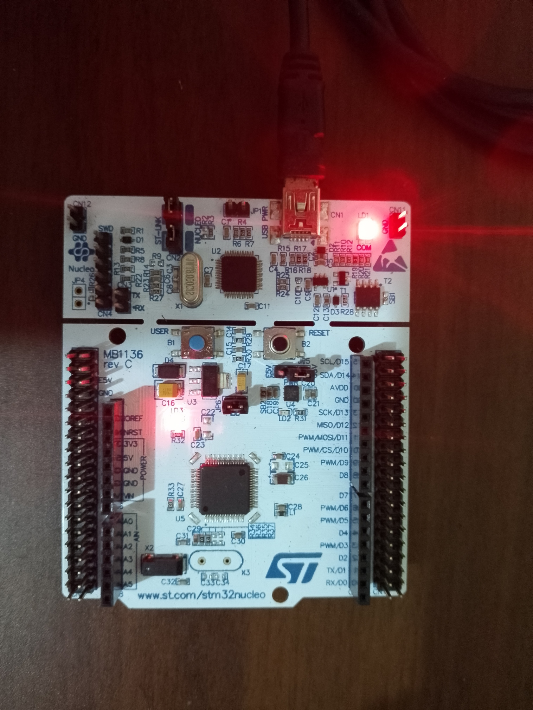 |

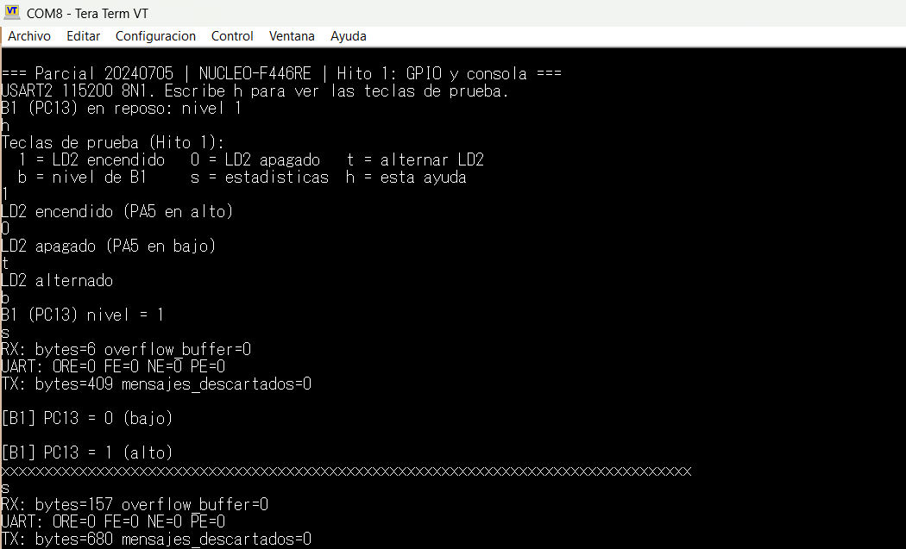

Más evidencia: `evidencias/hito1/01_compilacion_0_errores.png` y `evidencias/hito1/02_carga_en_placa.png`.

### Hito 2: interrupciones, tick y antirrebote

- Compilación: 0 errores y 0 advertencias (text 23 140 B, data 92 B, bss 4 028 B).
- Tick de 1 ms con la interrupción de TIM6 (PSC 83, ARR 999). La comparación con SysTick dio una diferencia acumulada de 1 ms en unos 9,5 s.
- B1 por interrupción EXTI13 en ambos flancos. La ISR solo incrementa un contador de flancos; el antirrebote de 30 ms, la clasificación y los contadores se hacen en `main`, una vez por tick.
- Pulsación corta (de 30 ms a menos de 1500 ms, al soltar) y larga (una sola vez al llegar a 1500 ms, sin corta al soltar). Las duraciones se miden sobre el estado ya validado.
- 20 pulsaciones cortas dieron 20 eventos y 40 flancos (`flancos_isr`); mantener 10,7 s dio una sola larga; arrancar con B1 pulsado no genera eventos.
- Todas las diferencias de tiempo usan `(uint32_t)(ahora - antes)`. Con la tecla de prueba `w` se inyectó el contador a 2048 ms de UINT32_MAX y una pulsación larga cruzó el desbordamiento (`t=628 ms` tras la vuelta).
- Limitación: el botón casi no rebotó en la placa (2 flancos por pulsación); el filtrado de rebotes se verificó con rebotes simulados en las pruebas de PC.

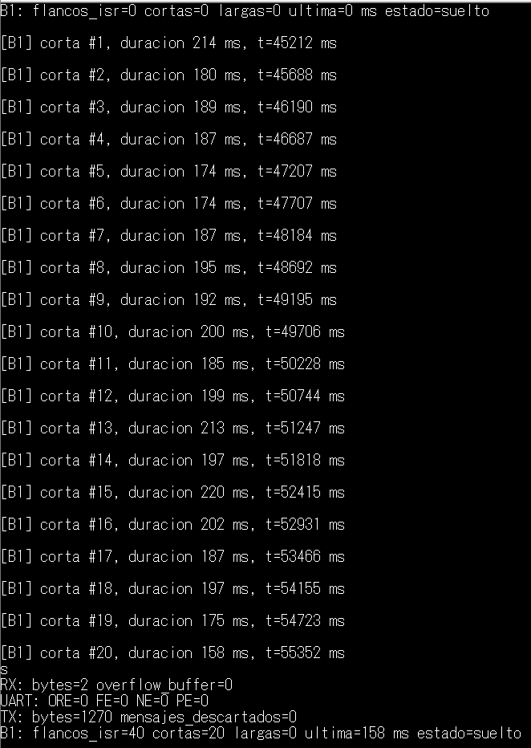

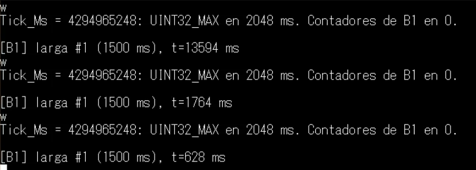

Más evidencia en `evidencias/hito2/` y detalle en `pruebas/hito2_resultados.md` y `analisis/tick_y_antirrebote.md`.

### Hito 3: TIMER y PWM

- Compilación: 0 errores y 0 advertencias (text 31 352 B, data 92 B, bss 4 280 B).
- PWM de hardware con TIM3 CH1 en PA6: 500, 1000 y 2000 Hz y duty entero de 0 a 100 %. Arranca en 1000 Hz y 25 %. ARR y CCR se calculan con el reloj real del temporizador; ARR y CCR tienen precarga y se escriben con las actualizaciones detenidas (`UDIS`), así que el cambio entra completo al final del periodo, sin periodos mezclados.
- 0 % usa `CCR = 0` y 100 % usa `CCR = ARR + 1`: el hardware deja la salida en nivel constante, sin pulsos residuales (verificado en la medición: cero flancos en 200 ms).
- Medición interna con TIM2 (PA0, puente desde PA6) y autoprueba de 15 combinaciones sin esperas (tecla `a`): **15/15 correctas**, error de frecuencia +0,00 % y error de duty máximo de -0,01 puntos. Sin el puente, 3/15 (solo las de 0 %).
- El tick de 1 ms (TIM6) no cambió durante los 15 cambios de configuración: TIM6 +3300 ms y SysTick +3300 ms.
- 42 errores inyectados a propósito en el código fueron detectados por las pruebas de PC.
- Limitación: la medición es interna y comparte reloj con el PWM; no sustituye a un instrumento independiente (ver «Verificación de frecuencia y duty del PWM»).

| Autoprueba con el puente: 15/15 OK | Autoprueba sin el puente: 3/15 OK |
|---|---|
| 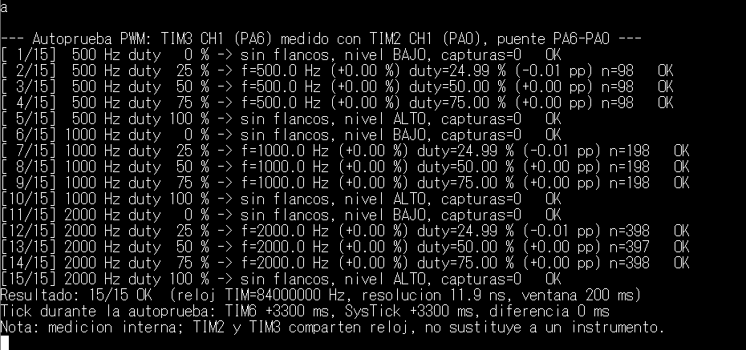 | 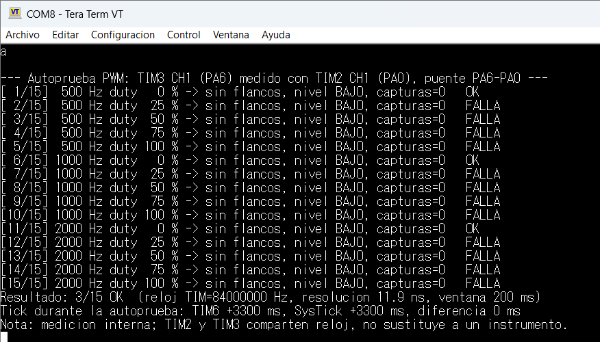 |

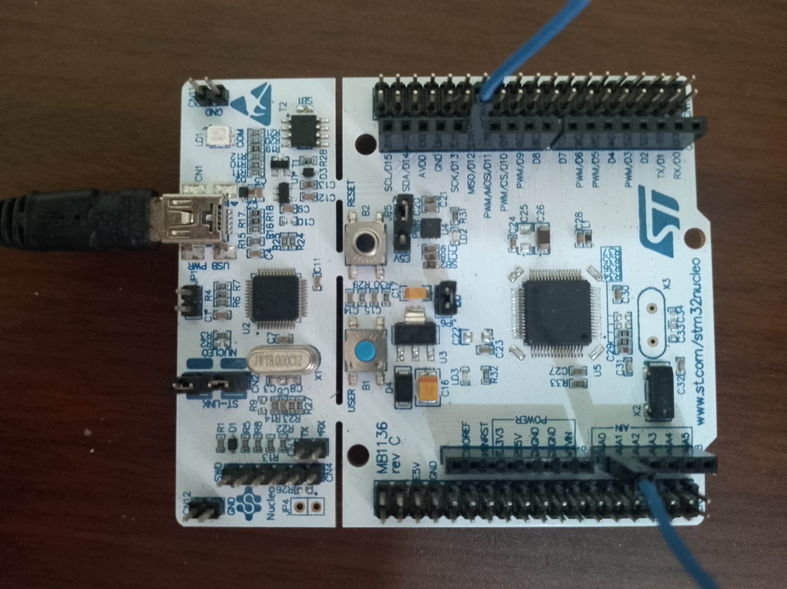

Más evidencia en `evidencias/hito3/` y detalle en `pruebas/hito3_resultados.md` y `analisis/pwm_y_medicion.md`.

### Hito 4: integración y comandos

- Compilación y carga correctas en STM32CubeIDE 2.2.0. La aplicación de pruebas de los Hitos 1 a 3 (teclas sueltas) se reemplazó por la aplicación real.
- Máquina de estados MANUAL / AUTO / PAUSA. AUTO sube de 10 % a 90 % y baja, 1 punto cada 20 ms (1,6 s por tramo, ciclo de 3,2 s), empezando en 10 % subiendo. LD2: fijo en MANUAL, 500 ms en AUTO, 125 ms en PAUSA. PAUSA pone el PWM en 0 % y conserva el modo previo, el duty manual, la frecuencia, el valor y la dirección de la rampa; `RESUME` y la pulsación larga continúan desde ahí sin recuperar los pasos del tiempo en pausa.
- B1: corta = MANUAL ↔ AUTO; larga (1,5 s, una sola vez, sin corta al soltar) = entrar o salir de PAUSA; la corta en PAUSA se ignora. Los contadores de cortas, largas e ignoradas se ven en `STATUS`.
- Consola: órdenes en mayúsculas, una por línea, de hasta 63 caracteres, terminadas en CR, LF o CRLF (CRLF cuenta como una sola). Los números se validan completos (`20abc`, `-1`, `101` y números enormes se rechazan sin cambiar nada). Una línea demasiado larga se descarta hasta su terminador y responde `ERR OVERFLOW`; la siguiente orden funciona.
- Sin bloqueos ni esperas: el parser, las respuestas y la telemetría corren en `main`; las interrupciones (EXTI13, TIM6, USART2) solo anotan datos. Las respuestas esperan a que quepan enteras en la cola de transmisión (1024 bytes) en lugar de cortarse. Todas las comparaciones de tiempo usan `(uint32_t)(ahora - antes)`.
- `STREAM ON` emite una línea `TEL` cada 1000 ms (separadas exactamente 1000 ms en la placa) y una línea `EVT B1 ...` por cada pulsación.
- Órdenes `DIAG` (no forman parte del protocolo; se pueden desactivar con `APP_DIAG_ENABLED`): `DIAG MEASURE` (medición interna con el puente PA6-PA0), `DIAG PWMALL`, `DIAG STALL n` y `DIAG WRAP`, para provocar el desbordamiento de RX y el cruce de UINT32_MAX en las pruebas.
- Medición con `DUTY 40` y `FREQ 500`: f = 500,0 Hz (+0,00 %), duty = 39,99 % (-0,01 puntos), n = 98.
- 110 errores inyectados a propósito en el código fueron detectados por las pruebas de PC.
- Observación: pegando un bloque de órdenes justo tras un reset, la primera línea respondió `ERR COMMAND` dos veces; escrita a mano o con una línea en blanco antes funciona. Se atribuye a un byte invisible del texto copiado, no confirmado (detalle en `pruebas/hito4_resultados.md`).
- Limitaciones: si se pierde o daña un byte de RX se vacía el buffer y puede perderse una orden válida que esperaba (nunca se ejecuta un fragmento). Las pruebas de aceptación con registros completos de CR/LF/CRLF, 100 caracteres, 10 órdenes por segundo, desbordamiento de RX y UINT32_MAX se hicieron en el Hito 5.

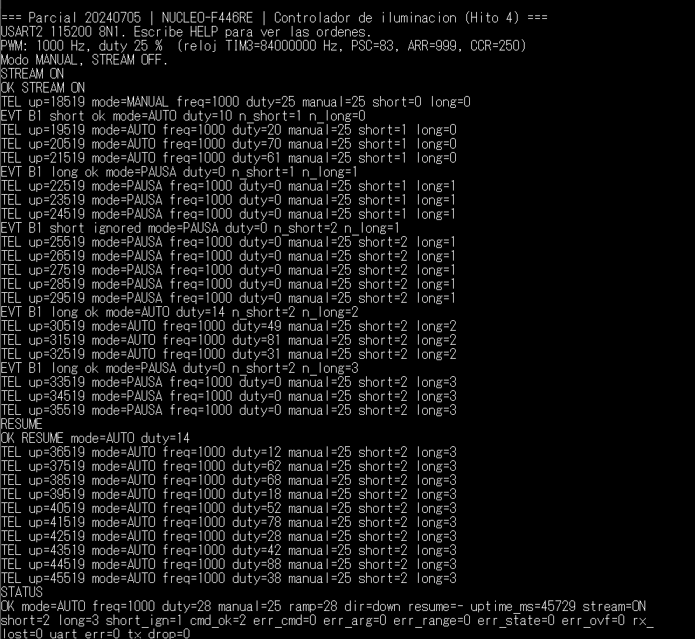

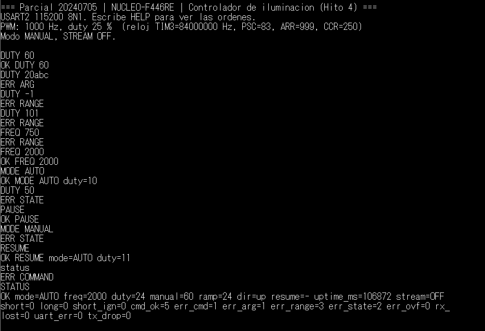

Más evidencia en `evidencias/hito4/` y detalle en `pruebas/hito4_resultados.md` y `analisis/estados_y_comandos.md`.

### Hito 5: pruebas, correcciones y entrega final

- Las 13 pruebas de aceptación pasaron en la placa con el firmware del Hito 4, sin corregir el código (tabla de «Pruebas de aceptación»).
- Ocho macros de Tera Term (`pruebas/herramientas/prueba_00_*.ttl` ... `prueba_07_*.ttl`) envían las órdenes con bytes y ritmo exactos y guardan cada sesión en `evidencias/hito5/*.log`; la prueba del botón se hizo a mano y se registró en `prueba_08_boton.log`.
- `analizar_logs.py` comprueba cada registro (respuestas exactas, contadores, telemetría separada 1000 ms, rampa de AUTO contra el modelo triangular): 124 de 124 comprobaciones correctas, salida en `evidencias/hito5/analisis_logs.txt`.
- Carga: 300 órdenes con `STREAM ON`, AUTO y B1 activos, sin errores ni pérdidas. El ritmo en la placa fue de 8,1 órdenes/s (la macro de Windows no alcanza 10/s; el ritmo exacto de 10/s durante 30 s se cumple en las pruebas de PC).
- Desbordamiento de RX: 233 bytes perdidos con la placa sin leer 3 s, un `ERR OVERFLOW`, y la siguiente orden se ejecutó sin ejecutar fragmentos.
- Cruce de UINT32_MAX: la telemetría pasó de `up=4294967248` a `up=952` con separación de 1000 ms y la rampa siguió a 20 ms por punto.
- Limitaciones: los tiempos de respuesta (100 ms) y del botón (50 ms) no se midieron en la placa con un reloj externo; la medición del PWM es interna (ver arriba).

Detalle en `pruebas/hito5_resultados.md`.

## Estado actual

- Hecho: los cinco hitos. Proyecto base generado con CubeMX (TIM3 PWM, TIM6 tick, TIM2 medidor, USART2, EXTI13 y LD2),
  GPIO y consola (Hito 1), tick de 1 ms, EXTI de B1 y antirrebote (Hito 2), PWM de hardware y medición interna (Hito 3),
  máquina de estados, rampa de AUTO, intérprete de órdenes, telemetría e integración (Hito 4) y las 13 pruebas de aceptación
  con registros completos (Hito 5), todo probado en la placa.
- Entrega: repositorio, video (enlace al inicio de este README) y resultados de pruebas en `pruebas/hito5_resultados.md`.
- Limitaciones conocidas: la medición del PWM es interna y comparte reloj con el PWM (ver «Verificación de frecuencia y duty del PWM»);
  los tiempos de respuesta de 100 ms y 50 ms no se midieron en la placa con un reloj externo; la prueba de carga en la placa alcanzó
  8,1 órdenes/s; las órdenes `DIAG` no forman parte del protocolo del enunciado; si se pierde un byte de RX puede perderse una orden
  válida que esperaba en el buffer (detalle en `analisis/estados_y_comandos.md`).
- Errores conocidos: ninguno confirmado. Observado en el Hito 4: el primer comando pegado tras un reset respondió `ERR COMMAND` en dos
  ocasiones, atribuido a un byte invisible del texto copiado; no se repitió en las ocho macros del Hito 5 (ver `pruebas/hito4_resultados.md`
  y `pruebas/hito5_resultados.md`).
